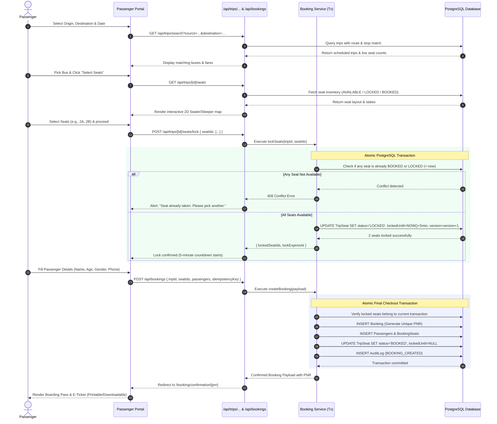
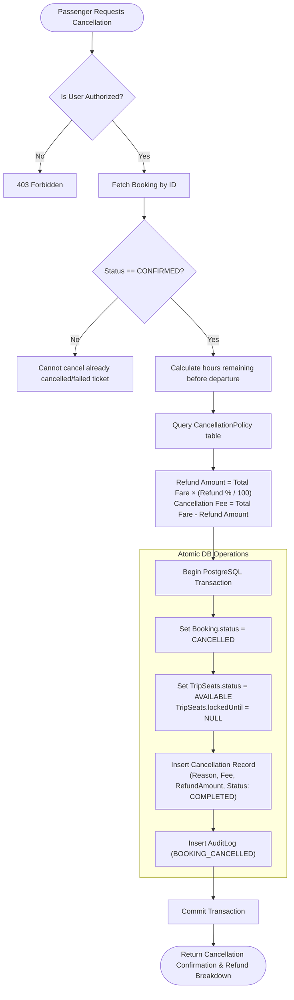
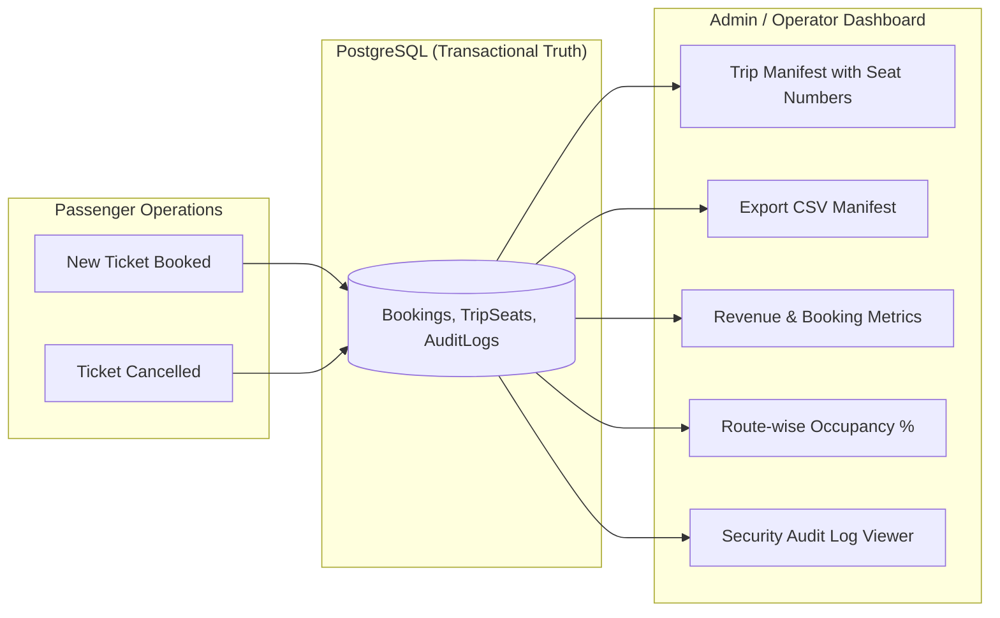
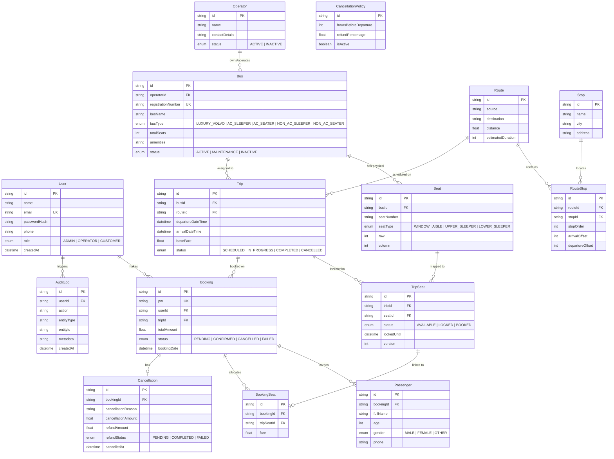

# Bus Booking Management System — System Architecture & Workflow Guide

A production-minded, full-stack Bus Booking Management System built with Next.js 15 (App Router), TypeScript, PostgreSQL, Prisma ORM, and Tailwind CSS.

---

## 1. System Architecture & High-Level Design

The application follows a **modular monolithic architecture** with strict separation of concerns across presentation, API, service, and database layers:

```
┌────────────────────────────────────────────────────────────────────────┐
│                        PRESENTATION LAYER                              │
│   Passenger Portal (Landing, Search, Interactive Layout, My Bookings) │
│   Admin / Operator Dashboard (Buses, Routes, Trips, Manifests, Reports)│
└──────────────────────────────────┬─────────────────────────────────────┘
                                   │ HTTPS / JSON / Route Handlers
┌──────────────────────────────────▼─────────────────────────────────────┐
│                     API & CONTROLLER LAYER                             │
│   /api/auth/*     /api/trips/*     /api/bookings/*     /api/admin/*    │
└──────────────────────────────────┬─────────────────────────────────────┘
                                   │ Zod Schema Validation & RBAC Guard
┌──────────────────────────────────▼─────────────────────────────────────┐
│                    BUSINESS LOGIC / SERVICE LAYER                      │
│   booking.service.ts   cancellation.service.ts   report.service.ts     │
│   - Atomic Seat Locks (PostgreSQL Tx + Version Checks)                 │
│   - Idempotency & Conflict Guards (PNR Generation)                     │
│   - Tiered Departure Refund Calculation Engine                         │
└──────────────────────────────────┬─────────────────────────────────────┘
                                   │ Prisma Client (Prepared Queries)
┌──────────────────────────────────▼─────────────────────────────────────┐
│                    DATABASE / PERSISTENCE LAYER                        │
│   PostgreSQL: Normalized Models, Row-level Versioning, Unique Index   │
│   [User, Bus, Seat, Route, RouteStop, Trip, TripSeat, Booking, ...]   │
└────────────────────────────────────────────────────────────────────────┘
```

---

## 2. Core End-to-End Workflows

### 2.1 The Complete Booking Lifecycle (Passenger)
The application guarantees concurrency safety using an atomic lifecycle:
`AVAILABLE` $\rightarrow$ `LOCKED` (5-minute window) $\rightarrow$ `BOOKED`.



---

### 2.2 Dynamic Cancellation & Refund Workflow
Cancellations calculate dynamic refunds based on hours remaining before departure:



---

### 2.3 Real-Time Fleet & Admin Synchronization
Bookings and cancellations immediately update administrative screens without manual refreshes:



---

## 3. Database Relational Model (ER Diagram)



---

## 4. Role-Based Access Control (RBAC) Matrix

| Capability / Resource | Public Guest | Customer | Fleet Operator | Super Admin |
| :--- | :---: | :---: | :---: | :---: |
| Search Buses & Routes | ✅ | ✅ | ✅ | ✅ |
| View Bus Seat Layouts | ✅ | ✅ | ✅ | ✅ |
| Lock Seats & Checkout | ❌ | ✅ | ❌ | ✅ |
| View Personal Bookings | ❌ | ✅ | ❌ | ✅ |
| Cancel Eligible Bookings | ❌ | ✅ | ❌ | ✅ |
| View Passenger Manifests | ❌ | ❌ | ✅ (Assigned) | ✅ (All) |
| Export Manifest to CSV | ❌ | ❌ | ✅ | ✅ |
| Create / Edit Buses & Seats | ❌ | ❌ | ❌ | ✅ |
| Manage Routes & Stops | ❌ | ❌ | ❌ | ✅ |
| Schedule Trips | ❌ | ❌ | ❌ | ✅ |
| View Revenue & Analytics | ❌ | ❌ | ❌ | ✅ |
| View Audit Trail Logs | ❌ | ❌ | ❌ | ✅ |

---

## 5. Quick Start & Execution

1. **Install Dependencies**: `pnpm install`
2. **Apply DB Schema**: `pnpm prisma db push`
3. **Seed Database**: `pnpm prisma:seed`
4. **Run Vitest Suite**: `pnpm test` (22 unit, integration, and E2E tests)
5. **Start Dev Server**: `pnpm dev` (http://localhost:3000)

