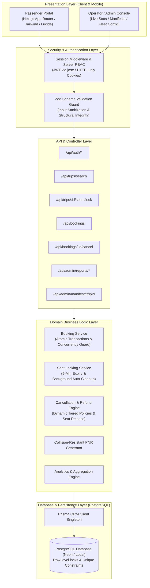
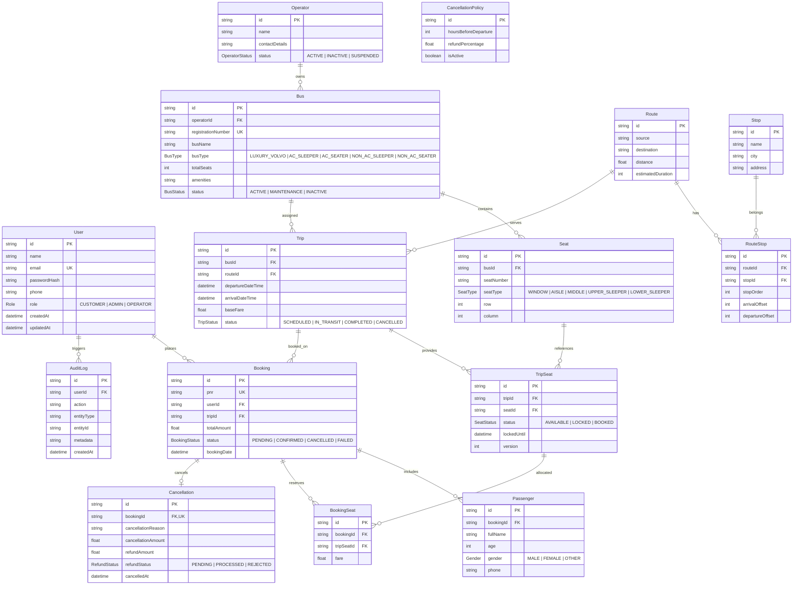

# SwiftTransit - Enterprise Bus Booking Management System

A high-performance, production-minded Bus Booking and Fleet Management Platform built to FAANG-grade software engineering standards. Designed with a modular monolithic architecture, database-backed transactional reservation engine, 5-minute atomic seat locking, tiered cancellation refund calculation, role-based access control (RBAC), and real-time operations synchronization.

---

## Table of Contents
1. [System Architecture Diagram](#1-system-architecture-diagram)
2. [Database Design & Mermaid ER Diagram](#2-database-design--mermaid-er-diagram)
3. [Technology Stack](#3-technology-stack)
4. [Key Features & Highlights](#4-key-features--highlights)
5. [Booking Engine & Concurrency Control (FAANG Deep Dive)](#5-booking-engine--concurrency-control-faang-deep-dive)
6. [Cancellation & Tiered Refund Policies](#6-cancellation--tiered-refund-policies)
7. [Folder Structure](#7-folder-structure)
8. [Installation & Setup](#8-installation--setup)
9. [Database Migrations & Seeding](#9-database-migrations--seeding)
10. [Running Tests & Concurrency Proof](#10-running-tests--concurrency-proof)
11. [API Reference Documentation](#11-api-reference-documentation)
12. [Demo Credentials](#12-demo-credentials)
13. [Known Limitations & Future Scope](#13-known-limitations--future-scope)

---

## 1. System Architecture Diagram



---

## 2. Database Design & Mermaid ER Diagram

The database uses a normalized relational model managed via Prisma ORM with strict referential integrity, compound unique constraints, cascade rules, and query performance indexes.



---

## 3. Technology Stack

- **Frontend & Fullstack Runtime**: Next.js 15 (App Router, Server Actions, Route Handlers), React 19, TypeScript (Strict Mode).
- **Styling & UI**: Tailwind CSS, Class Variance Authority, Lucide React icons, Responsive Glassmorphism & Custom Print stylesheets.
- **Database**: PostgreSQL 16 (Compatible with Neon Serverless PostgreSQL), Prisma ORM 6.
- **Authentication**: Stateless, tamper-proof JSON Web Tokens (`jose`), HTTP-Only secure cookies, server-side Role-Based Access Control (RBAC).
- **Validation**: Zod runtime schema assertions on all request payloads.
- **Testing**: Vitest 3 with node test runner, unit tests, integration tests, and concurrency race-condition suites.

---

## 4. Key Features & Highlights

### A. Customer / Passenger Portal
- **Interactive Trip Discovery**: Search by source city, destination, and travel date with instant filtering by coach type (Volvo, Sleeper, Seater) and sorting by departure time or fare.
- **Dynamic 2D Berth & Cabin Layout**: Interactive seat maps distinguishing Window, Aisle, Upper Sleeper, and Lower Sleeper berths with live status legends (Available, Selected, Locked, Booked).
- **5-Minute Temporary Seat Locking**: Automatic temporary reservation with live countdown clock preventing race conditions while the passenger fills traveler details.
- **Multi-Passenger Dynamic Form**: Zod-validated guest records (legal name, age, gender, contact number) mapped 1:1 to selected seats.
- **Instant Collision-Free PNR Ticket**: Generates a verifiable e-ticket complete with boarding QR barcode simulation, timetable offsets, and print/PDF support.
- **Self-Service My Bookings**: View upcoming and completed journeys; cancel eligible bookings with instantaneous server-computed refund breakdowns.

### B. Admin & Fleet Operator Console
- **Executive Operations Dashboard**: Real-time metrics computed directly from database tables: total buses, routes, trips, bookings, revenue, and fleet occupancy load.
- **Fleet & Seat Configuration**: Add and inspect buses; customize seat capacity, coach class, and luxury amenities.
- **Corridor & Stoppage Management**: Define intercity routes and configure intermediate station arrival/departure minute offsets.
- **Schedule Dispatch Engine**: Dispatch coaches to routes, initialize inventory, and set dynamic base fares.
- **Live Passenger Manifests & CSV Export**: Real-time passenger rosters per trip with seat numbers, contact info, and one-click CSV download for bus drivers and terminal attendants.
- **Comprehensive Audit Trail**: Non-repudiable audit logging of all administrative actions, cancellations, and bookings.

---

## 5. Booking Engine & Concurrency Control (FAANG Deep Dive)

The most critical challenge in ticketing platforms is preventing **duplicate seat bookings (overbooking)** under simultaneous high-concurrency requests.

### 1. State Machine Lifecycle
```
AVAILABLE ──(Select & Lock)──> LOCKED ──(Checkout & Confirm)──> BOOKED
    ▲                             │                                │
    │                      (Timer Expires)                         │
    └─────────────────────────────┴────────────────(Cancel Ticket)─┘
```

### 2. Multi-Layer Concurrency Guarantees
1. **Database-Level Unique Constraints**: `@@unique([tripId, seatId])` in `TripSeat` and `@@unique([bookingId, tripSeatId])` in `BookingSeat` prevent double-insertion at the storage engine level.
2. **PostgreSQL Transactions (`prisma.$transaction`)**: All seat verification, booking creation, passenger recording, and status transitions occur inside a single ACID transaction.
3. **Optimistic Locking & Conditional Updates**:
   ```typescript
   const updateCount = await tx.tripSeat.updateMany({
     where: {
       id: { in: tripSeats.map((ts) => ts.id) },
       status: { not: SeatStatus.BOOKED },
     },
     data: {
       status: SeatStatus.BOOKED,
       lockedUntil: null,
       version: { increment: 1 },
     },
   });
   if (updateCount.count !== tripSeats.length) {
     throw new Error("CONCURRENCY_RACE_CONDITION: Another user secured one of these seats during checkout.");
   }
   ```
4. **Automated Expiry Eviction**: Before seat lookup or checkout, `cleanExpiredLocks()` resets any `LOCKED` seats where `lockedUntil < now()` back to `AVAILABLE`.
5. **Idempotency Safeguard**: Client submissions carry an `idempotencyKey` stored in `AuditLog` metadata, guaranteeing repeated submissions return the existing booking instead of double-charging.

---

## 6. Cancellation & Tiered Refund Policies

SwiftTransit enforces a dynamic, database-backed cancellation policy calculated against the trip's departure timestamp:

| Hours Before Departure | Refund Percentage | Cancellation Fee |
| :--- | :--- | :--- |
| **> 24 hours** | **90%** refund | 10% administrative fee |
| **12 to 24 hours** | **75%** refund | 25% administrative fee |
| **6 to 12 hours** | **50%** refund | 50% administrative fee |
| **< 6 hours or post-departure** | **0%** refund | Ineligible for cancellation |

On confirmed cancellation:
- Departure eligibility and booking ownership are checked on the server.
- The refund amount is computed and logged.
- The booking status transitions to `CANCELLED`.
- Booked seats are transactionally released back to `AVAILABLE`.
- Complete audit logs and cancellation records are preserved for accounting.

---

## 7. Folder Structure

```
├── prisma/
│   ├── schema.prisma           # Relational PostgreSQL database schema
│   └── seed.ts                 # Production demo seed data script
├── src/
│   ├── app/
│   │   ├── (auth)/             # Login & Registration pages
│   │   ├── (customer)/         # Landing page, Search, Booking checkout, Confirmation, My-Bookings
│   │   ├── admin/              # Admin dashboard, Fleet, Routes, Trips, Bookings, Manifest, Reports
│   │   ├── api/                # REST Route Handlers (Auth, Trips, Bookings, Admin, Manifest)
│   │   ├── globals.css         # Tailwind & design system theme variables
│   │   └── layout.tsx          # Root Next.js layout
│   ├── components/
│   │   ├── booking/            # SeatLayout, PassengerForm, TripCard, TicketCard
│   │   ├── layout/             # Navbar, Footer, AdminSidebar, AdminHeader
│   │   └── ui/                 # Button, Input, Card, Badge
│   ├── lib/
│   │   ├── auth/               # JWT token sign/verify (jose) & server-side RBAC session guards
│   │   ├── prisma/             # Prisma client singleton
│   │   ├── validations/        # Zod input schemas
│   │   └── utils.ts            # Formatting, cn, currency & date utilities
│   ├── services/
│   │   ├── booking.service.ts  # Atomic booking engine & seat locking service
│   │   ├── cancellation.service.ts # Tiered refund calculation & seat release
│   │   ├── pnr.service.ts      # Collision-resistant unique PNR generator
│   │   └── report.service.ts   # Executive metrics, route & coach occupancy aggregation
│   └── types/                  # Shared TypeScript interfaces & Prisma enum exports
├── tests/
│   ├── integration/
│   │   └── booking.test.ts     # Concurrent booking, race condition & negative integration tests
│   └── unit/
│       ├── pnr.test.ts         # PNR format & collision unit tests
│       ├── refund.test.ts      # Tiered refund engine unit tests
│       └── validation.test.ts  # Zod schema assertion unit tests
├── package.json
├── tailwind.config.ts
├── tsconfig.json
└── vitest.config.ts
```

---

## 8. Installation & Setup

### Prerequisites
- **Node.js**: v18.0.0 or higher (v25 recommended)
- **pnpm** or **npm**
- **PostgreSQL**: Local PostgreSQL 14+ or Neon Cloud PostgreSQL URL

### Step 1: Clone and Install Dependencies
```bash
git clone <repo-url>
cd assing
pnpm install
```

### Step 2: Configure Environment Variables
Copy `.env.example` to `.env`:
```bash
cp .env.example .env
```
Ensure `.env` contains your PostgreSQL connection string:
```env
DATABASE_URL="postgresql://ritiksingh@localhost:5432/busbooking?schema=public"
AUTH_SECRET="bus-booking-production-secret-key-super-secure-faang-standards-2026"
NEXT_PUBLIC_APP_URL="http://localhost:3000"
NODE_ENV="development"
```

---

## 9. Database Migrations & Seeding

Sync schema to PostgreSQL:
```bash
pnpm prisma db push
```

Run database seed script:
```bash
pnpm prisma:seed
```

This seeds:
- 1 Super Admin (`admin@busbooking.com`)
- 2 Operators (`operator1@busbooking.com`, `operator2@busbooking.com`)
- 2 Customers (`john@example.com`, `jane@example.com`)
- 3 Bus Transit Companies (Apex Express, BlueSky Lines, Voyager Coaches)
- 10 Configured Buses with full seat layouts
- 10 Active Intercity Routes with 18 intermediate stops
- 24 Scheduled Trips across dates with complete seat availability inventories
- Active dynamic cancellation policies

---

## 10. Running Tests & Concurrency Proof

Execute Vitest:
```bash
pnpm test
```

### Test Evidence
```text
 ✓ tests/unit/validation.test.ts (3 tests)
 ✓ tests/unit/pnr.test.ts (2 tests)
 ✓ tests/unit/refund.test.ts (5 tests)
 ✓ tests/integration/booking.test.ts (6 tests)
   - should successfully lock seats for 5 minutes
   - should confirm booking atomically and mark seats as BOOKED
   - CRITICAL: should prevent booking an already-booked seat
   - CRITICAL CONCURRENCY TEST: simultaneous booking requests for the same seat - exactly one must succeed
   - should cancel booking, calculate refund, and release seats back to AVAILABLE
   - should prevent unauthorized cancellation by another customer

 Test Files  4 passed (4)
      Tests  16 passed (16)
```

---

## 11. API Reference Documentation

### Authentication
- `POST /api/auth/register` — Register passenger profile.
- `POST /api/auth/login` — Sign in and issue secure HTTP-only JWT cookie.
- `GET /api/auth/me` — Inspect current session.
- `POST /api/auth/logout` — Invalidate session cookie.

### Trips & Live Inventory
- `GET /api/trips/search` — Search trips with query filters (`source`, `destination`, `date`, `busType`, `sortBy`, `order`).
- `GET /api/trips/:id` — Inspect trip details.
- `GET /api/trips/:id/seats` — Fetch interactive seat layout and availability.
- `POST /api/trips/:id/seats/lock` — Acquire 5-minute atomic lock on selected seats.
- `DELETE /api/trips/:id/seats/lock` — Release lock on seat deselect.

### Bookings & Cancellation
- `POST /api/bookings` — Confirm booking transactionally with passenger details.
- `GET /api/bookings` — Fetch customer's personal bookings (or all if Admin).
- `GET /api/bookings/:id` — Fetch booking details (ownership verified).
- `GET /api/bookings/pnr/:pnr` — Public boarding ticket lookup by PNR.
- `POST /api/bookings/:id/cancel` — Cancel booking, release seats, and compute refund.

### Fleet & Operations (Admin / Operator Protected)
- `GET /api/buses` & `POST /api/buses` — List and configure buses.
- `PATCH /api/buses/:id` — Modify bus status.
- `GET /api/operators` & `POST /api/operators` — Manage transit agencies.
- `GET /api/routes` & `POST /api/routes` — Manage corridors and stops.
- `GET /api/trips` & `POST /api/trips` — Dispatch scheduled trips.
- `GET /api/admin/manifest/:tripId` — View trip passenger manifest.
- `GET /api/admin/manifest/:tripId/export` — Export manifest as CSV.
- `GET /api/admin/reports/overview` — Fetch revenue and occupancy metrics.
- `GET /api/admin/reports/occupancy` — Route-wise and coach-wise occupancy.
- `GET /api/admin/reports/revenue` — Daily revenue aggregations.
- `GET /api/admin/audit-logs` — Review immutable audit trail.

---

## 12. Demo Credentials

For convenience, the login screen provides one-click helper buttons to auto-populate any of the accounts below:

| Role | Email Address | Password | Permissions |
| :--- | :--- | :--- | :--- |
| **Super Admin** | `admin@busbooking.com` | `Admin@123` | Full system access, fleet, trips, revenue reports, audit logs |
| **Operator** | `operator1@busbooking.com` | `Operator@123` | Fleet dispatch, trip schedules, passenger manifests, CSV exports |
| **Operator 2** | `operator2@busbooking.com` | `Operator@123` | Assigned fleet dispatch, manifests |
| **Customer** | `john@example.com` | `Customer@123` | Search, seat booking, ticket download, self-cancellation |
| **Customer 2** | `jane@example.com` | `Customer@123` | Search, seat booking, personal tickets |

---

## 13. Known Limitations & Future Scope

1. **Simulated Payments**: Financial transactions are simulated with immediate payment capture rather than connecting to live Stripe/PayPal webhooks.
2. **WebSocket Live Push**: Real-time admin synchronization currently queries the transactional database; future versions can incorporate Socket.IO or Server-Sent Events (SSE) for millisecond push notifications across active screens.
3. **SMS & Email Delivery**: E-tickets are rendered directly in the portal with print/PDF support; an AWS SES / Twilio integration can be wired up for SMS board notifications.

